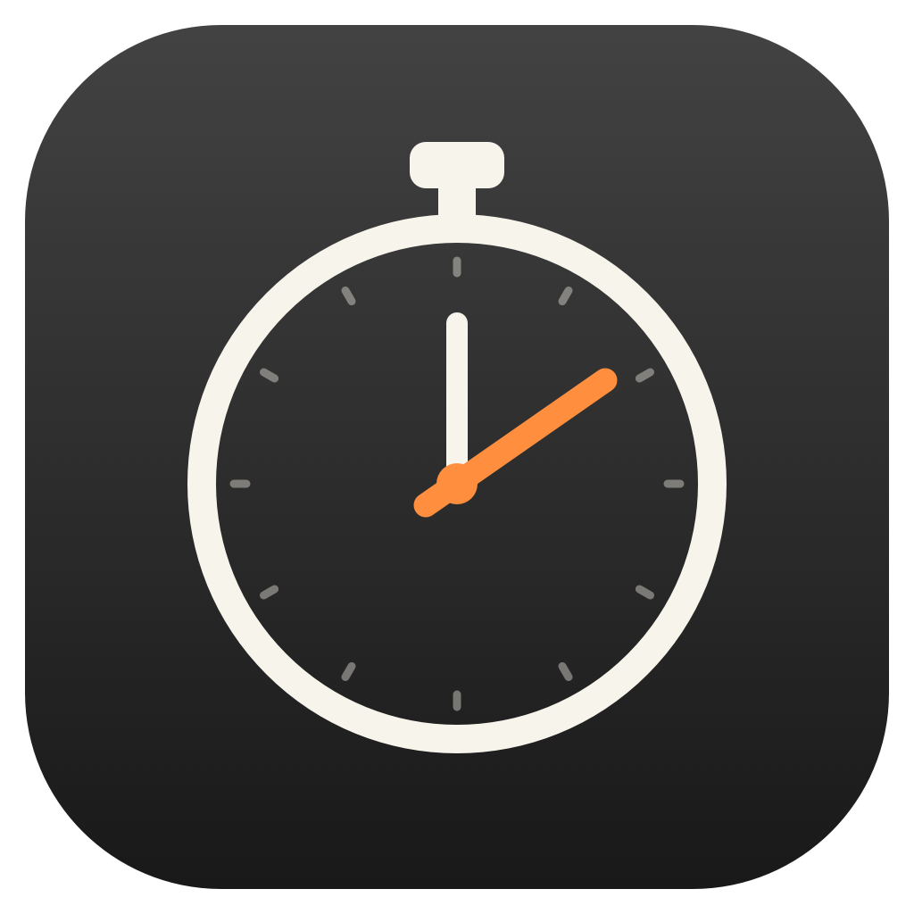

<p align="center"></p>

<h1 align="center">stopwatch</h1>
Sick of bloated software that doesn't work.

Just trying to make a stopwatch and timer for macOS with intuitive UX and a sleek UI.

## Install

Download the latest **stopwatch DMG** from [Releases](https://github.com/GregoryLi360/dumb-clock/releases), open it, and drag **stopwatch** into **Applications**.

**Requires macOS 13 Ventura or later.** The app runs natively on Apple Silicon and Intel Macs.

Releases are ad-hoc signed, **not Apple-notarized**. If macOS blocks the downloaded app, use **System Settings → Privacy & Security → Open Anyway** after attempting to open it.

## Use

- **Stopwatch / Timer** switches modes. Each keeps its own time.
- **Play / Pause** starts or pauses. **Reset** stops and resets the selected mode.
- **Clock / #** switches between analog and digital views. Both modes have hour, minute, and second hands plus an `HH:MM:SS` display.
- **Timer editing:** click a digit while stopped or paused. The block highlight shows exactly what typing will replace. Left/right skip colons; deletion zeroes digits without removing positions. Up/down adjusts the selected unit. Selecting all highlights digits only.
- **Drag a timer hand** to set its unit. Click elsewhere on the dial to set minutes. Dragging across 12 carries into the next unit. Editing is disabled while running.
- **Pin** keeps the window on top; unpin restores normal window stacking. Hovering a pinned icon shows a slash; an unpinned icon stays outlined and brightens.
- **×** hides the window. Use the menu bar icon to show it again or quit.

| Shortcut | Action |
| --- | --- |
| Space | Start / pause; silence a finished timer |
| Return | Apply a duration and start |
| R | Reset |
| ⌘Q | Quit |

At zero, the countdown shows its window and repeats the system Glass sound until stopped. Hidden timers continue running. Time includes sleep, but an alert waits until the Mac wakes. Quitting clears active sessions. Mode, view, duration, pin state, and window placement are remembered.

Starting, pausing, resuming, and resetting keep the layout fixed. Switching digital/analog view intentionally changes the window height.

## Build

Install Apple's Command Line Tools or Xcode, then:

```sh
./scripts/test.sh
./build.sh
open "build/stopwatch.app"
```

Build the DMG:

```sh
./scripts/package.sh
```

Written in Swift and AppKit. Packaging uses `dmgbuild`. Run `./scripts/render-assets.sh` to regenerate the icon and installer artwork.

There's a release workflow template in `docs/release-workflow.yml.example`; it isn't enabled.

## License

[MIT](LICENSE).
